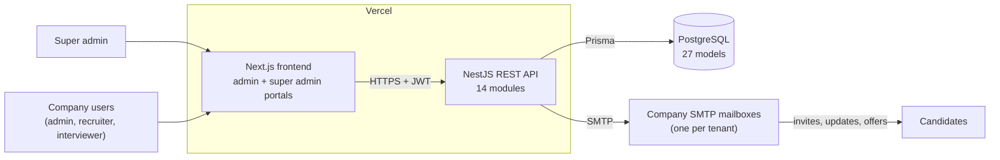
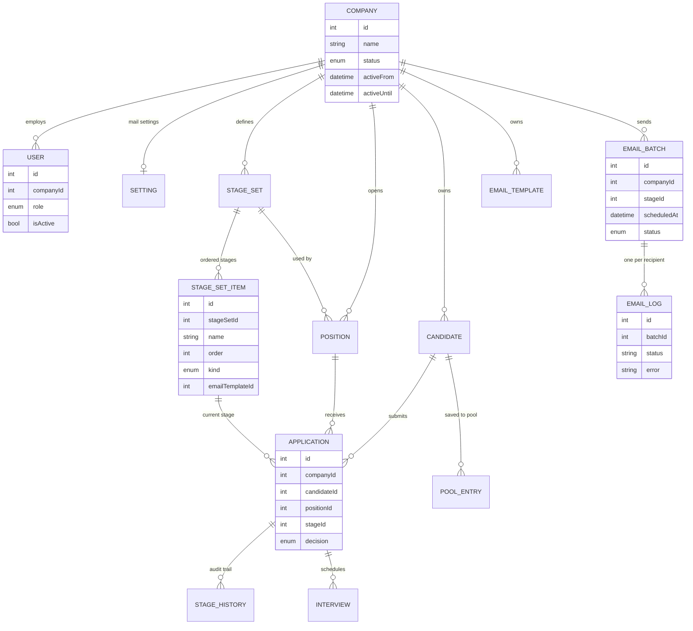
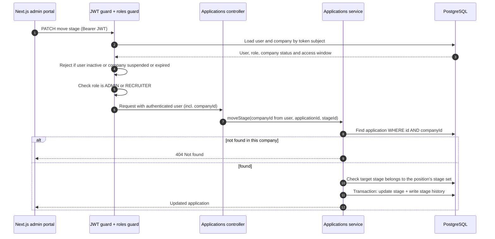
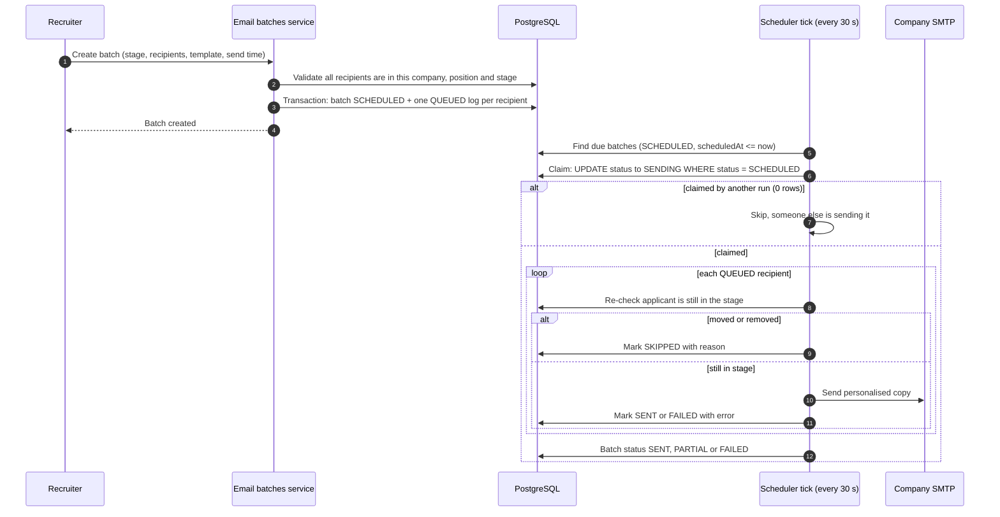

# Hiring Manager: a multi-tenant hiring platform

> Architecture case study. The source code is private; this page describes the design only.

**Stack:** Next.js 16 · React 19 · TypeScript · TanStack Query · Tailwind CSS · shadcn/ui · NestJS · Prisma 7 · PostgreSQL · Nodemailer · Vercel

**Team:** me and one teammate · **Timeline:** about 12 days from first commit to deployment

---

## The problem

Small and mid-sized companies often run hiring from spreadsheets and personal inboxes. Candidates get lost between stages, interview invites go out by hand, and every company wants a slightly different process.

The goal was a single SaaS platform where many companies can each run their own hiring, completely separated from each other:

- post positions and define their own hiring stages
- move candidates through a visual pipeline
- schedule interviews and send stage emails from their own company mailbox
- keep good candidates in a talent pool for future roles

A platform owner (super admin) onboards companies and controls how long each one has access.

## My role

I designed the overall architecture and data model and built most of the backend API and the frontend: authentication and roles, companies and users, positions and categories, the stage and pipeline model, candidates with CV parsing, the talent pool, per-company mail settings, and the admin and super admin portals. My teammate focused on the email side, including email templates, attachments, the scheduled bulk email feature and interview slot booking. We reviewed and merged each other's work throughout.

## What it does

- **Two portals in one Next.js app:** a super admin portal for managing companies, and a company admin portal for everything else.
- **Positions** with categories, a reusable requirements library, salary and experience ranges, and weighted skills (must-have and nice-to-have).
- **Configurable pipeline:** each company defines named stage sets, reorders stages by drag and drop, and moves candidates between stages on a kanban board.
- **Candidates:** CV upload (PDF or DOCX) with text extraction to pre-fill the profile, notes, skills, and a match score against a position's requirements.
- **Interviews:** typed interviews (for example technical or HR), interviewer, mode and location, with slot booking when inviting a group.
- **Talent pool:** save promising candidates by category and get suggestions when a matching position opens.
- **Email:** templates with placeholders, attachments, sending from the company's own SMTP mailbox, and bulk sends that can be scheduled up to a year ahead.

## Architecture overview

The system is a classic three-tier web application, kept deliberately simple.

- **Frontend (Next.js App Router):** route groups for authentication, the admin portal and the super admin portal. Data fetching goes through a small typed API layer with one folder per domain (queries, mutations and cache keys on top of TanStack Query), so pages never call `fetch` directly. A single HTTP client attaches the bearer token and signs the user out on a 401.
- **API (NestJS):** 14 feature modules (auth, users, companies, positions, position categories, stages, candidates, applications, interviews, emails, talent pool, skills, settings and types), plus shared core modules for Prisma, mail and authentication. Global validation strips unknown fields from every request, and a global interceptor and exception filter give every response the same envelope.
- **Data (PostgreSQL via Prisma):** 27 models split across domain schema files (company, positions, stages, candidates, applications, emails, talent pool and so on), evolved through versioned migrations.
- **Mail:** outgoing email goes through each company's own SMTP account, so candidates see the company as the sender.

### System context and deployment



### Core data model (simplified)

Almost every business table carries a `companyId`. Tables that don't (stage items, stage history, interviews, email logs) are only reachable through a parent that does.



### Key flow: a tenant-scoped request

This is what happens when a recruiter moves a candidate to another stage. The company is never taken from the request; it comes from the signed-in user.



### Key flow: scheduled bulk email



## Key design decisions and trade-offs

### 1. Tenant isolation in the data model and the service layer

**Decision.** Every tenant-owned table has a `companyId` column, an index on it, and tenant-scoped unique keys (for example a candidate email is unique per company, not globally). The `companyId` used by any query comes only from the authenticated user, which the JWT strategy reloads from the database on every request. Every service method takes `companyId` as its first argument and includes it in every lookup, and child records are always reached through a tenant-owned parent. Cross-references are validated inside the tenant too: an email template, interview type or stage set can only be attached if it belongs to the same company.

```text
// illustrative pseudo-code
companyId = authenticatedUser.companyId        // never from the body or URL
application = find Application where id = :id and companyId = companyId
if none -> 404                                 // other tenants' rows look like "not found"
```

**Trade-offs.**
- It is explicit and easy to read and review, and it needs no database-specific features.
- It is enforced by convention and code review, not by the database. A new query that forgets `companyId` would not be caught automatically. The natural next step is to enforce it lower down, with a Prisma client extension that injects the tenant filter or PostgreSQL row-level security, so the guarantee doesn't depend on every developer remembering.
- A shared database with a tenant column is much cheaper to run than a schema or database per tenant, at the cost of weaker physical separation.

### 2. The hiring pipeline is data, not code

**Decision.** Stages are rows, not an enum. A company creates named **stage sets** (reusable process templates), each with ordered **stage items**. A stage item has a name, colour, order and a `kind` (applied, shortlisted, interview, offered, hired, rejected or a plain stage), and can link a default email template and interview type. A position points at a stage set, an application points at its current stage item, and every move is written to a **stage history** table.

Only a few kinds carry behaviour. Moving to a *rejected* stage closes the application, records the decision and remembers where it was rejected. Moving to *hired* closes it. Moving back out of a closed stage reopens it. Everything else is configuration the company controls, including drag-and-drop reordering in the UI.

**Trade-offs.**
- Companies can model their own process without any code change or deploy, and the stage history gives an audit trail for free.
- The rules that do exist have to be defined in terms of `kind`, not stage names, so the code never depends on what a company calls its stages.
- Integrity takes more care: stage order is unique per set, a stage that still has applications or interviews can't be deleted, and a move is only allowed to a stage of the same position's set. Positions that share a stage set also share edits to it, which is the point of templates but has to be made clear in the UI.

### 3. Role-based access at the controller boundary

**Decision.** Four roles: **super admin** (platform owner, belongs to no company), **admin**, **recruiter** and **interviewer**. Access is declared with a roles decorator on each controller and overridden per route where needed. For example, interviewers can read the pipeline and applications but can't move or delete them. A global JWT guard and a roles guard enforce it before any service code runs.

The JWT strategy also checks the user's account and company on every request: inactive users are rejected, and company users are rejected if their company is suspended, not yet active or past its access end date. A super admin can therefore cut off a company immediately, without waiting for tokens to expire.

**Trade-offs.**
- Rules sit in one visible place per endpoint instead of being scattered through business logic.
- Reloading the user on each request costs one indexed database read per call. For this workload that is a good price for instant revocation; at much higher traffic it could be cached briefly.
- Roles are coarse. If companies later need custom permissions, this would grow into a permission table rather than more hard-coded roles.

### 4. Per-company mail accounts

**Decision.** Each company stores its own SMTP settings, and interview and stage emails go out from that mailbox, so replies reach the company directly. The SMTP password is encrypted at rest with AES-256-GCM using a key held only in the server environment, and it is never returned by the API.

**Trade-offs.**
- Better deliverability and trust than a shared platform sender, and no shared sending reputation between tenants.
- Each company has to configure SMTP correctly, so the system reports "mail not configured" clearly instead of failing silently, and a misconfigured mailbox only affects that company.

### 5. Safe-to-retry scheduled bulk email

**Decision.** A bulk send is stored as an **email batch** plus one **email log row per recipient** in status `QUEUED`, created in a single transaction. A scheduler wakes every 30 seconds, finds due batches, and **claims** each one with a conditional update (`SCHEDULED` to `SENDING` only if it is still `SCHEDULED`). If two runs race, only one claims the batch and the other does nothing.

Delivery works per recipient. Only `QUEUED` rows are sent, and each one is marked `SENT`, `FAILED` or `SKIPPED` with a reason. At send time the system re-checks that the applicant is still in that stage, and fills the placeholders with fresh data, so nobody receives an interview invite for a stage they have already left. If the server restarts mid-send, a batch stuck in `SENDING` for more than 15 minutes goes back to `SCHEDULED`, and only the recipients still `QUEUED` are sent. Cancelling a scheduled batch cancels its queued emails, releases the interview slots it booked, and restores any earlier interviews those slots had replaced.

**Trade-offs.**
- Retrying is safe at the batch and recipient level: a re-run never re-sends to someone already marked `SENT`, and the final status (`SENT`, `PARTIAL` or `FAILED`) is accurate.
- It is at-least-once rather than exactly-once. If the process dies after the SMTP server accepts a message but before its row is marked `SENT`, that one recipient could get it twice. Closing that gap fully would need provider-side idempotency keys, which plain SMTP doesn't offer.
- The scheduler runs inside the API process, which is simple and needs no extra infrastructure, but it assumes a long-running instance. On a purely serverless host the tick would move to an external cron trigger calling the same claim-and-send logic, which works unchanged because the claim is already atomic.

## Other details worth noting

- **CV parsing:** uploaded PDF and DOCX files are converted to text to pre-fill candidate details, which saves recruiters retyping.
- **Explainable matching:** positions carry adjustable weights for must-have skills, nice-to-have skills, experience, salary and notice period, and applications store the matched and missing skills next to the score, so a recruiter can see why a candidate scored as they did.
- **Consistent API surface:** request DTOs are validated and whitelisted globally, responses share one envelope, and the API is documented with OpenAPI (Swagger).
- **Stored files** such as email attachments are kept outside the public uploads folder and only served to users of the owning company.

---

[Back to all case studies](../README.md)
