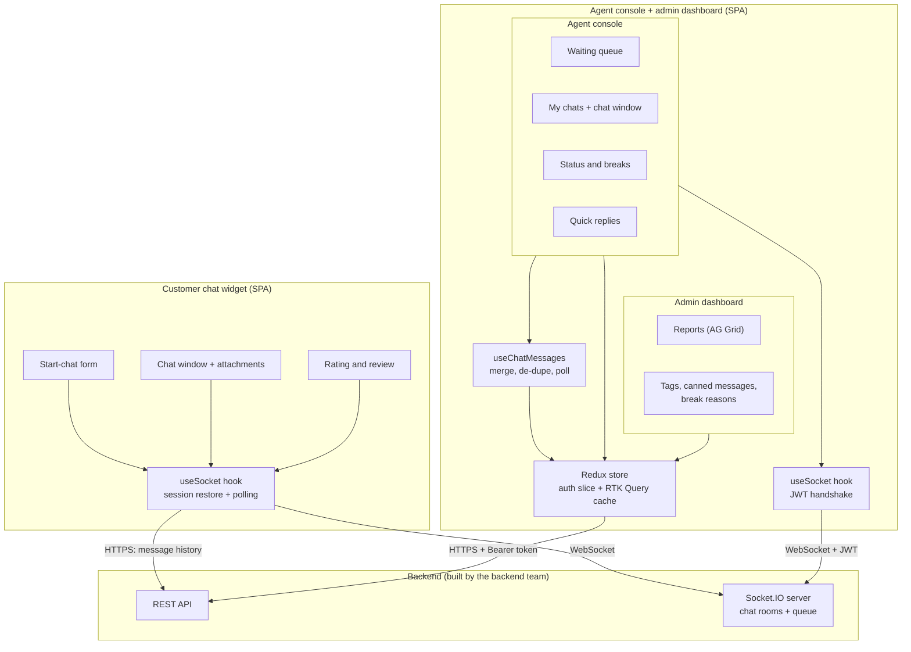
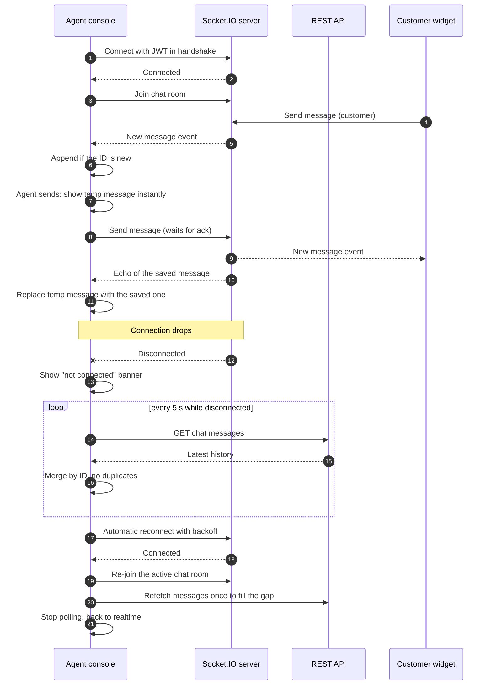

# Sky Chat: real-time contact-centre live chat

> Architecture case study. The source code is private client work; this page describes the frontend architecture only.

**Stack:** React 18 · TypeScript · Vite · Tailwind CSS · shadcn/ui (Radix) · Redux Toolkit + RTK Query · Socket.IO client · AG Grid · Vercel

**My role:** only frontend developer. I built every client application and integrated them with the backend team's REST and Socket.IO APIs.

---

## The problem

A contact centre needs to answer customers in real time, in their own language, with many agents working at once. That means:

- customers must be able to start a chat from the website without creating an account
- waiting chats must reach a free agent quickly, and agents must see the queue live
- a message must never silently disappear, even on an unreliable mobile connection
- supervisors need reports on agent activity, breaks and performance

## What I built

Three browser applications share one backend:

| App | Users | Main features |
|---|---|---|
| **Customer chat widget** | Website visitors | Start-chat form, live conversation, file and image attachments, emoji, session restore after a page reload, star rating and review when the chat ends. Customer-facing text is in Bangla. |
| **Agent console** | Contact-centre agents | Live queue of waiting chats, accept a chat, multiple active chats, quick replies, agent status and breaks with reasons, browser notifications, connection status banner. |
| **Admin dashboard** | Supervisors and admins | User and archived-user reports, active agents, hourly and overall agent performance, break, login and edit reports, plus settings for tags, canned messages and break reasons. |

The agent console and admin dashboard live in one React app with shared authentication and layout. The customer widget is a separate, lightweight single-page app so it can be embedded on the public site without carrying agent code.

## Architecture overview

- **Server state through RTK Query.** Chats, messages, the waiting queue and reports are RTK Query endpoints with cache tags, so a mutation such as accepting or ending a chat automatically refreshes the affected lists. A shared base query attaches the agent's token to every request.
- **Realtime through one Socket.IO connection per tab.** A custom hook owns the socket's lifecycle and exposes typed actions (join or leave a chat room, send, accept, end) and events (new message, chat assigned, queue updated, typing, presence). Components never touch the socket directly.
- **One merged message list.** The UI shows the REST history merged with realtime messages and optimistic local messages, de-duplicated by message ID. Nothing has to choose between sources.
- **Auth state in Redux.** The token and current user live in an auth slice. Protected routes redirect to login when there is no session.

### Component diagram



### Realtime message flow with reconnect and polling fallback



## Key design decisions and trade-offs

### 1. Authenticated agents, lightweight customer sessions

**Decision.** Agent and admin connections pass the user's JWT in the Socket.IO handshake, and every REST call carries the same token, so the server knows exactly which agent is on each socket. Customers don't log in. A customer starts a chat with a short form, and the widget stores only the chat session reference in the browser, so a page reload or a dropped connection can rejoin the same conversation instead of starting over. When the server reports a session as invalid or ended, the widget clears it and starts fresh.

**Trade-offs.**
- No sign-up friction for customers, which matters a lot for a support channel.
- The customer side is only as strong as the session reference, so the server must treat it as untrusted: it validates the chat on every rejoin and closes ended chats.

### 2. Optimistic sends with server reconciliation

**Decision.** When an agent or customer sends a message, it appears immediately with a temporary ID. The send waits for a server acknowledgement, and the server's echo of the saved message replaces the temporary one. If the server rejects it, the message is marked as failed in place instead of disappearing.

```text
// illustrative pseudo-code
show(tempMessage)                        // instant feedback
ok = await socket.send(message, ack)     // server acknowledgement
if (!ok) mark(tempMessage, "failed")
on echo(saved): replace(tempMessage, saved)
```

**Trade-offs.**
- The chat feels instant, even on slow mobile networks.
- The temporary message is matched to its echo by sender and content, because the client doesn't send its own message ID. Two identical messages sent back to back could be paired with the wrong echo. A client-generated message ID that the server echoes back would make reconciliation exact, and it is the first change I would make.
- If no acknowledgement arrives within a few seconds, the console assumes success rather than blocking the agent, and relies on the echo, the history merge and the reconnect refetch to correct the view. That favours responsiveness over strict confirmation.

### 3. Reconnect, room rejoin and a polling fallback

**Decision.** Socket.IO reconnects automatically with backoff. On every successful connect the client re-joins the active chat room, using the chat ID kept in session storage for agents and in the saved session for customers. While the agent's socket is down, RTK Query polls the message history every 5 seconds. The moment the socket is back, polling stops and one refetch fills any gap. The customer widget also polls the history every 5 seconds during an active chat as a safety net. All sources merge through a de-duplicated message list.

**Trade-offs.**
- A dropped connection degrades to slightly delayed messages instead of lost ones, and agents see a clear banner telling them the realtime link is down.
- Polling costs extra requests, so on the agent side it only runs while disconnected. The customer side polls more conservatively, which costs a small amount of traffic but protects the customer experience.
- Because several sources can deliver the same message, de-duplication by message ID is required everywhere. It lives in one hook instead of each component.

### 4. Separate apps per audience

**Decision.** The customer widget is its own small SPA. The agent console and admin dashboard share one app, because they share authentication, layout and most chat components.

**Trade-offs.**
- The public widget stays small and can be released without touching the agent tools, and agent code is never shipped to the public site.
- Some types and helpers are duplicated between the two codebases. A shared package for message types and socket event names would remove that drift, at the cost of a monorepo setup.

### 5. Data-heavy admin views on a grid component

**Decision.** Supervisor reports such as agent performance, hourly activity, breaks and logins use AG Grid with shared filter components, instead of hand-built tables.

**Trade-offs.**
- Sorting, filtering, column resizing and large row counts come for free, and every report behaves the same way.
- It adds a heavy dependency, but only to the admin area, not to the customer widget.

---

[Back to all case studies](../README.md)
